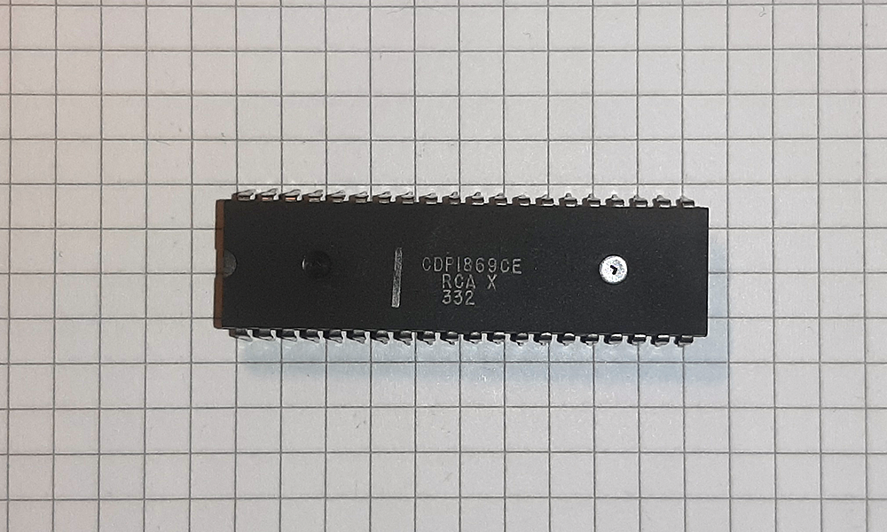

# CDP1869

> Parts of this README were generated using AI.

## General

Video and sound chip for RCA COSMAC-based computers.

In the COMX-35, the CDP1869 and CDP1870 worked as a pair for video. The 1869 also made the sound, with a programmable tone generator and a separate white-noise generator. [COMX-35 technical manual](https://www.comxclub.hobby-site.com/COMX35TechnicalManual.pdf) · [RCA datasheet](cdp1869.pdf)

## Files

- [CDP1869 datasheet](cdp1869.pdf)

## Links/Sources
- [COSMAC at Wikipedia](https://en.wikipedia.org/wiki/RCA_1802)
- [Comx-35 on Wikipedia](https://en.wikipedia.org/wiki/Comx-35)
- [Pecom 64 on Wikipedia](https://en.wikipedia.org/wiki/Pecom_64)
- [The Cosmac ELF (RCA 1802) Collection](https://archive.org/details/RCA_cdp_1802_information_collection)
