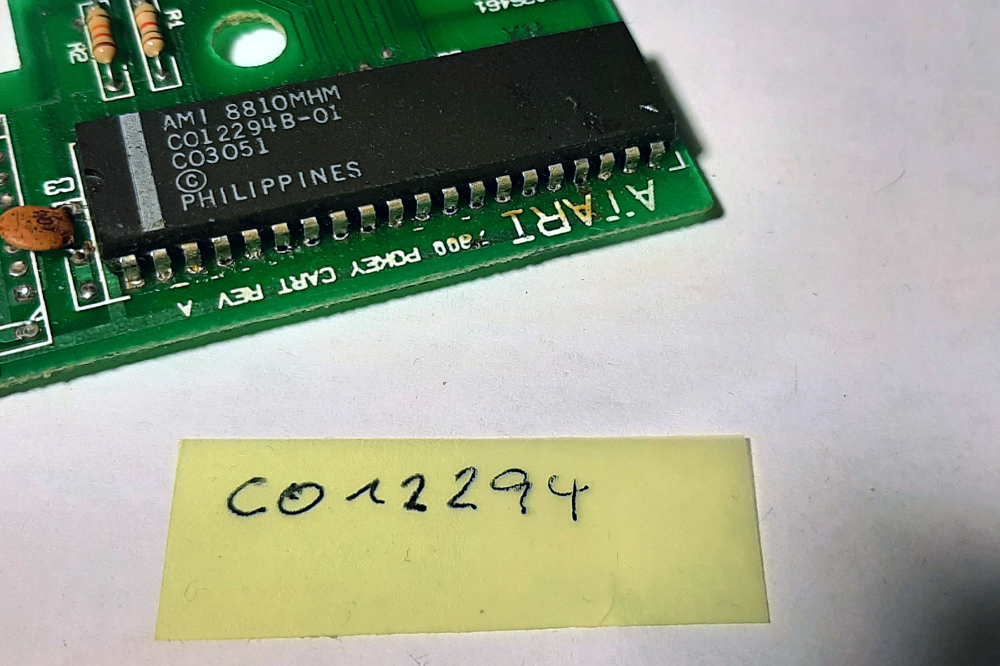
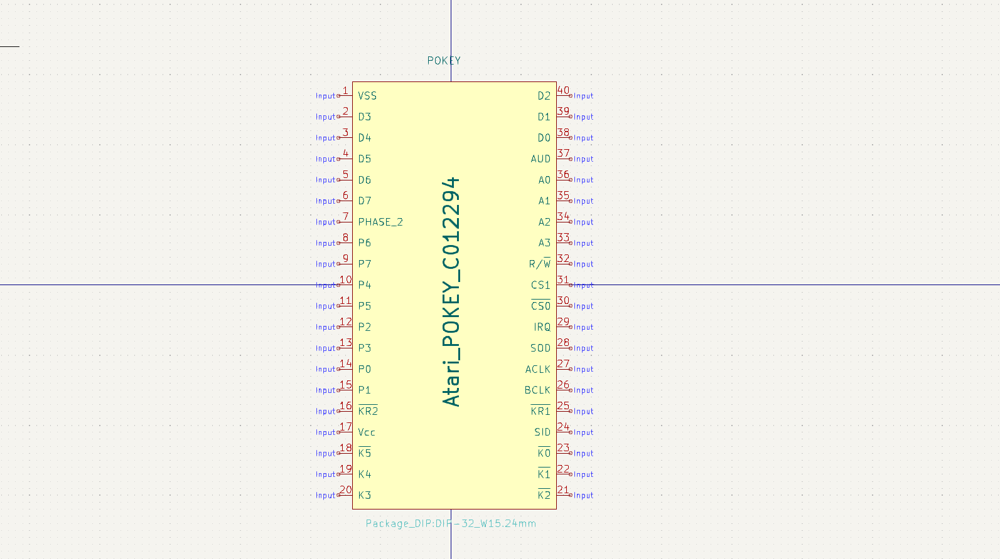

# CO12294 (POKEY)

> Parts of this README were generated using AI.

	

## General

- Atari 400/800
- Atari XL/XE
- Atari 5200
- Atari 7800 game cartridges (Ballblazer and Commando)
- Atari arcade systems

Atari’s *Major Havoc* arcade board went big on sound with four POKEYs in one cabinet. That’s 16 audio channels before pairing any of them for finer pitch control. [MAME’s Major Havoc board notes](https://github.com/mamedev/mame/blob/master/src/mame/atari/mhavoc.cpp)

## Files

- [POKEY reference](pokey.pdf)
- [POKEY / ESP32 Rev. A schematic PDF](POKEY_ESP32_RevA_EN/POKEY_ESP32_Schematic_RevA_EN.pdf)
- [POKEY project notes and editable schematic](POKEY_ESP32_RevA_EN/README.md)

## Links/Sources

- [Wikipedia](https://en.wikipedia.org/wiki/POKEY)
- [Detailed infos](http://krap.pl/mirrorz/atari/homepage.ntlworld.com/kryten_droid/Atari/800XL/atari_hw/pokey.htm)
