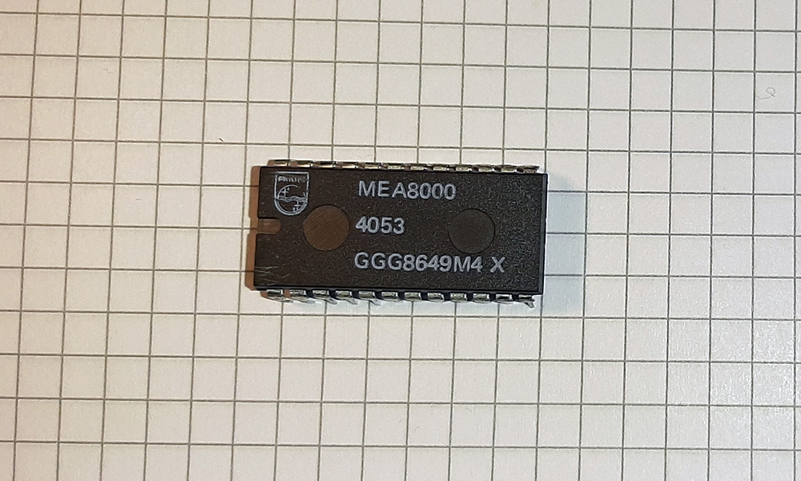

# MEA8000

> Parts of this README were generated using AI.

## General

	

The MEA8000 is a speech synthesizer fed with parameters by a host computer. The French company TMPI (Techni-musique & parole informatique) used it in speech add-ons for several 8-bit computers.

The host supplies the speech parameters, so it can also supply the accent or the intonation. For example, software can raise the pitch at the end of a question without changing the sounds that make up the words. [Signetics datasheet](MEA8000_Signetics.pdf)

## Files

- [Datasheet MEA8000](Datasheet_MEA8000.pdf)

## Links/Sources

[MEA8000 in CPC Wiki](https://www.cpcwiki.eu/index.php/MEA8000)

Thanks to George de Bouter for detailed information about this IC
