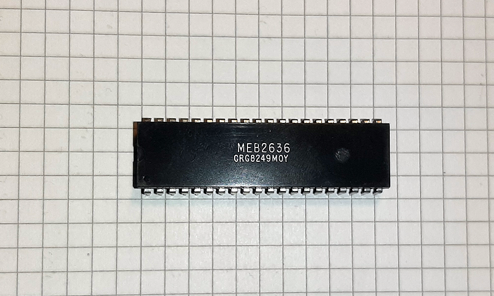

# MEB2636

> Parts of this README were generated using AI.

*MEB2636 (DIP-40).*

## General

Programmable Video Interface IC, intended for use in microprocessor-controlled game systems.

+ VC 4000 and clones

Also known as Signetics 2636

Inside the Interton VC 4000, the same chip drew the game objects, flagged their collisions and supplied a simple programmable tone. A game could check for a hit and play the beep through the same chip. [2636 PVI datasheet](2636PVI.pdf)

## Files

- [2636 PVI datasheet](2636PVI.pdf)

## Links/Sources
- [Wikibooks](https://en.wikibooks.org/wiki/Signetics_2650_%26_2636_programming/2636_PVI)
- [Wikipedia on Interton VC 4000](https://en.wikipedia.org/wiki/Interton_Video_Computer_4000)
- [Interton VC 4000 and clones](https://computer.fandom.com/wiki/VC_4000)

