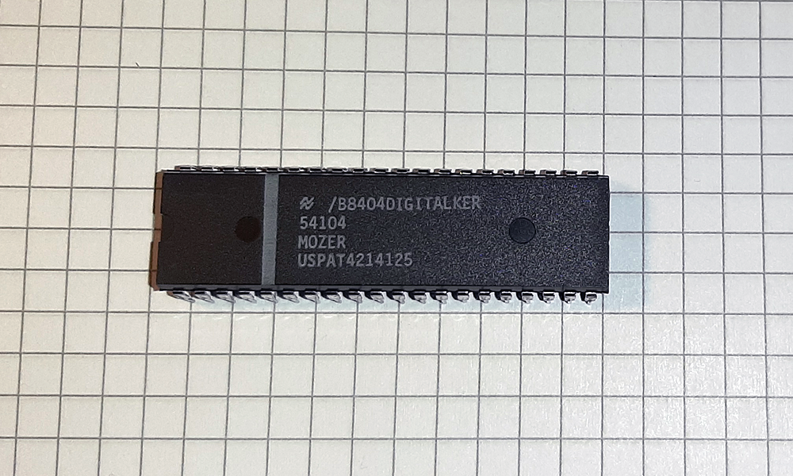
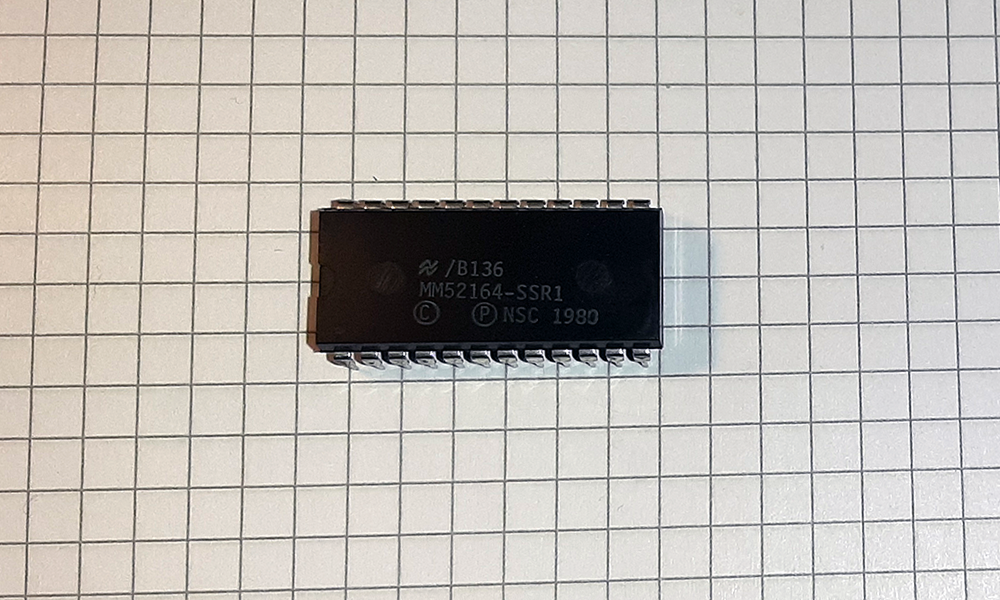
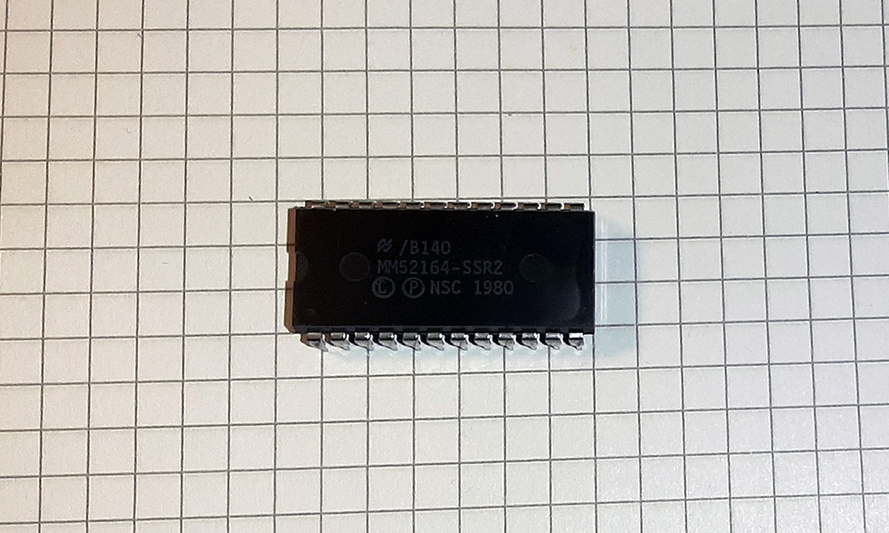

# MM54104

> Parts of this README were generated using AI.

## General

	

	

	

National Semiconductor’s Digitalker kit paired the chip with vocabulary ROMs. The SSR1 and SSR2 chips pictured here supplied a stock vocabulary of numbers, units and other words for talking instruments. A different set of ROMs gave the same chip a different vocabulary. [National Semiconductor’s Digitalker notes](AN252_Digitalker1986%20National%20Semiconductor%20Linear%20Applications%20Databook.pdf)

## Files

- [National Semiconductor Digitalker data book extract (1982)](Digitalker_NationalSemiconductorLinearDatabook1982%20%28extract%29.pdf)
- [Datasheet DT1050 Digitalker, Mozer](Datasheet_DT1050%20Digitalker%2C%20Mozer.pdf)
- [Datasheet DT1056 DT1057-VocabularyROMsDigitalker](Datasheet_DT1056_DT1057-VocabularyROMsDigitalker.pdf)
- [Build a Speech Synthesizer (1988-12) Example with 4 ROMs](Build%20a%20Speech%20Synthesizer%20%281988-12%29_Example%20with%204%20ROMs.pdf)

## Links/Sources

Thanks to George de Bouter for detailed information about this IC