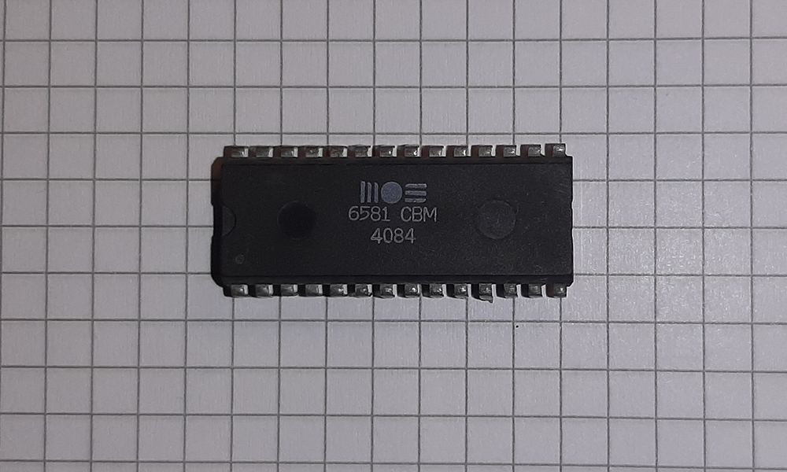
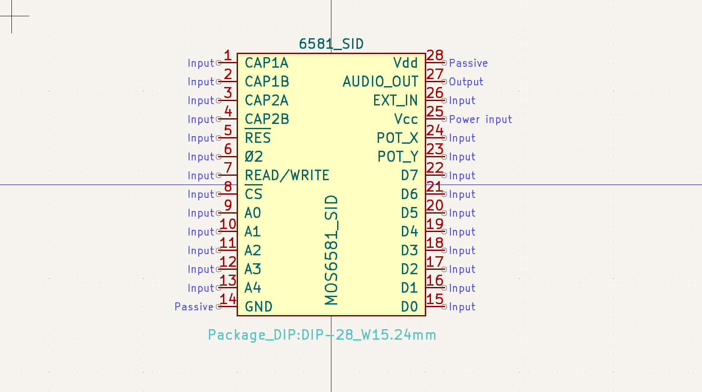

# MOS6581 (SID)

## General
- Commodore C64
- Commodore C128

One of the most famous 8-bit sound chips. Many DIY and commercial synthesizer projects are builded around this chip.

## Files

- [MOS6581 SID datasheet](mos_6581_sid.pdf)
- [C64 Service Manual 314001-02 1985 Feb](C64_Service_Manual_314001-02_1985_Feb.pdf)
- [C64-C64C Service Manual 1992-03 Commodore](C64-C64C_Service_Manual_1992-03_Commodore.pdf)

## Links/Sources
- [Wikipedia](https://en.wikipedia.org/wiki/MOS_Technology_6581)
- [MIDIbox SID V2](http://www.ucapps.de/index.html?page=midibox_sid.html)
- [Elektron SIDStation](https://www.elektron.se/en/legacy)
