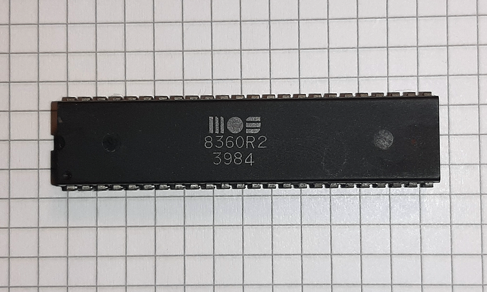

# MOS8360 (TED)

> Parts of this README were generated using AI.

## General
TED 7360/8360 - Text Editing Device (jokingly "Tramiels Exit Device"). The chip provided video, sound generation hardware, DRAM refresh circuitry, interval timers and keyboard input handling.

- Commodore C16
- Commodore C116
- Commodore Plus/4

The 7360 is another version of TED.

TED has 16 color codes and eight brightness settings, but all eight shades of black are still black. That leaves 121 distinct colors on the C16 and Plus/4. [Commodore TED hardware manual](TED%20System%20Hardware%20Manual.pdf)

## Channels
On each of two channels, you can choose a pitch in 1024 steps. Compared to the VIC, high notes are in tune, but the bass does not get below A2 (110 Hz). Low noise actually sounds like noise, although you may notice a pattern as it gets higher.

For both channels together, you can only choose one volume, from 0 to 8. Changing this volume, while either channel is on, produces a click; the greater the change, the louder. This allows to play unsigned PCM samples on a third channel.

Several games play only one melody with a chorus effect (using two slightly detuned channels). Very few drivers generate envelopes.

## Files

- [TED7360-datasheet](TED7360-datasheet.pdf)
- [TED System Hardware Manual](TED%20System%20Hardware%20Manual.pdf)

## Links/Sources
- [Wikipedia](https://en.wikipedia.org/wiki/MOS_Technology_TED)
- [C64 Wiki (German)](https://www.c64-wiki.de/wiki/TED)
