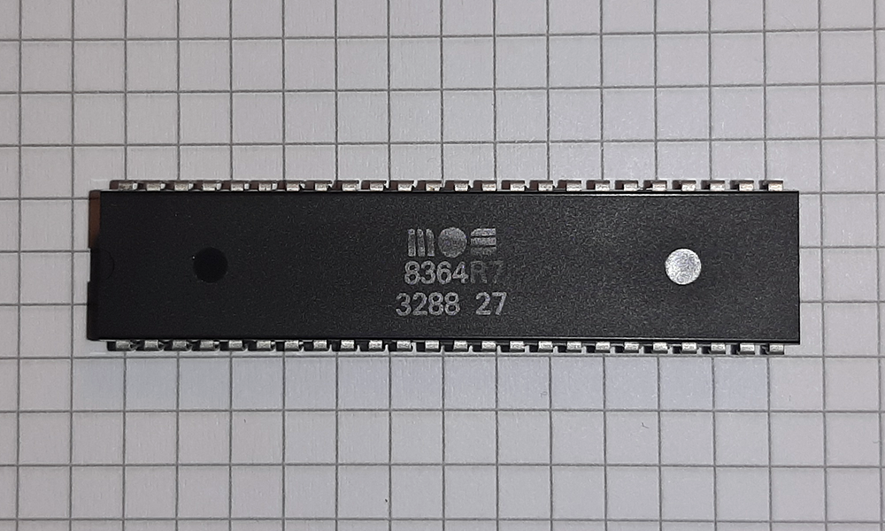

# MOS8364 (PAULA)

## General
- Commodore Amiga 500/1000/2000/CDTV

## Pin layout

| PIN #  |  DESIGNATION  |  FUNCTION  	             |  DEFINITION  |
|--------|---------------|---------------------------|--------------|
| 01-07  |  D8-D2        |  Data bus lines 8 to 2    |  I/O         |
| 08     |  VSS          |  Ground                   |  I			      |
| 09-10  |  D1-D0        |  Data bus lines 1 and 0   |  I/O			    |
| 11     |  RES*         |  System reset             |  I			      |
| 12     |  DMAL         |  DMA request line         |  O			      |
| 13-15  |  IPL0*-IPL2   |  Interrupt lines 0-2      |  O			      |
| 16     |  INT2*        |  Interrupt level 2        |  I			      |
| 17     |  INT3*        |  Interrupt level 3        |  I			      |
| 18     |  INT6*        |  Interrupt level 6        |  I			      |
| 19-26  |  RGA8-RGA1    |  Register address bus 8-1 |  I			      |
| 27     |  VCC          |  +5 Volt                  |  I			      |
| 28     |  CCK          |  Color clock              |  I			      |
| 29     |  CCKQ         |  Color clock delay        |  I			      |
| 30     |  AUDB         |  Right audio              |  O			      |
| 31     |  AUDA         |  Left audio               |  O			      |
| 32     |  POT0X        |  Pot 0X                   |  I/O			    |
| 33     |  POT0Y        |  Pot 0Y                   |  I/O			    |
| 34     |  VSSANA       |  Analog ground            |  I			      |
| 35     |  POT1X        |  Pot 1X                   |  I/O			    |
| 36     |  POT1Y        |  Pot 1Y                   |  I/O			    |
| 37     |  DKRD*        |  Disk read data           |  I			      |
| 38     |  DKWD*        |  Disk write data          |  O			      |
| 39     |  DKWE         |  Disk write enable        |  O			      |
| 40     |  TXD          |  Serial transmit data     |  O			      |
| 41     |  RXD          |  Serial receive data      |  I			      |
| 42-48  |  D15-D9       |  Data bus lines 15 to 9   |  I/O			    |

## Files

- [Amiga Hardware Reference Manual 1985 Commodore](Amiga_Hardware_Reference_Manual_1985_Commodore.pdf)
- [Amiga A500 A2000 Technical Reference Manual 1987](Amiga_A500_A2000_Technical_Reference%20Manual_1987.pdf)
- [Commodore A500 System Schematics](Commodore_A500_System_Schematics.pdf)
- [a500plus service manual 2014](a500plus_service_manual_2014.pdf)

## Links/Sources
- [Wikipedia](https://en.wikipedia.org/wiki/Original_Chip_Set#Paula)
