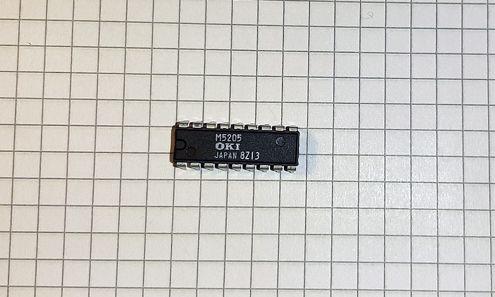

# MSM5205

> Parts of this README were generated using AI.

## General

*M5205.*

ADPCM playback chip. With a 384 kHz clock, its internal dividers offer 4, 6 or 8 kHz sample rates.

Capcom’s Japanese *Tiger Road* board (*Tora e no Michi*) added an MSM5205 for samples. The chip takes a stream of small changes in waveform level, which saves ROM space compared with storing full samples at the same rate. [MAME’s Tiger Road hardware notes](https://github.com/mamedev/mame/blob/master/src/mame/capcom/tigeroad.cpp) · [OKI datasheet](MSM5205.pdf)

## Files

- [MSM5205 datasheet](MSM5205.pdf)

## Links/Sources

- [Documentation at YSUtopia](https://www.ysutopia.net/special/MSM5205.htm#column-one)
- [MAME source](https://github.com/mamedev/mame/blob/master/src/devices/sound/msm5205.cpp)
- [OKI Voice Synthesis LSI Data Book 1987](http://www.bitsavers.org/components/oki/_dataBooks/1987_OKI_Voice_Synthesis_LSI_Data_Book.pdf)
- [OKI Voice Synthesis ICs 1994](http://www.bitsavers.org/components/oki/_dataBooks/1994_OKI_Voice_Synthesis_ICs.pdf)
- [FPGA Version with some insights](https://github.com/jotego/jt5205)
- [Arcade system Iren M-16](https://www.system16.com/hardware.php?id=737)
