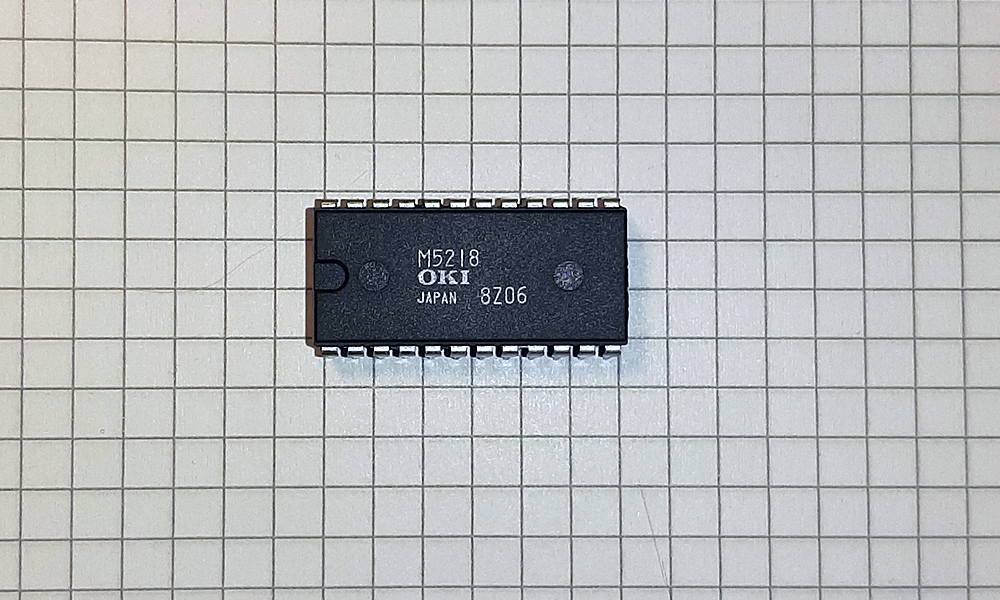

# MSM5218

## General

*M5218.*

## Files

- [MSM5218 datasheet](MSM5218.pdf)

## Links/Sources

- [OKI Voice Synthesis LSI Dta Book 1987](http://www.bitsavers.org/components/oki/_dataBooks/1987_OKI_Voice_Synthesis_LSI_Data_Book.pdf)
- [OKI Voice Synthesis ICs 1994](http://www.bitsavers.org/components/oki/_dataBooks/1994_OKI_Voice_Synthesis_ICs.pdf)