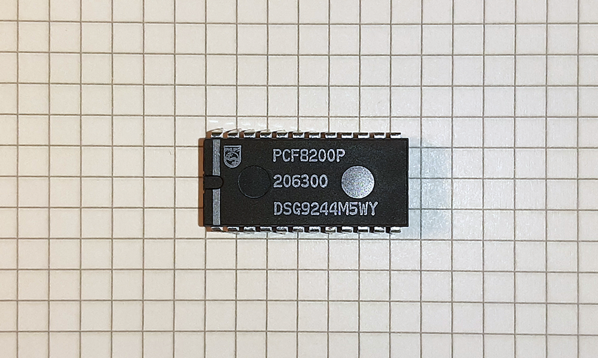

# PCF8200

> Parts of this README were generated using AI.

## General

	

Philips voice synthesizer and a successor to the [MEA8000](../MEA8000/).

The Multivox-8 used the PCF8200 to speak eight languages, including Hungarian, Arabic and Esperanto. The team’s site has recordings, so you can still hear its Esperanto. [Multivox-8 voice demos](https://www.magyarbeszed.hu/en/tts-multivox/multivox_01/)

## Files

- [PCF8200 datasheet](PCF8200_datasheet.pdf)

## Links/Sources

- [Paper describing aspects of speech synthesis systems as communication aids](https://www.isca-speech.org/archive_v0/archive_papers/eurospeech_1991/e91_0325.pdf)
- [Multivox System](https://www.magyarbeszed.hu/en/tts-multivox/multivox_01/)
- [I2C Tester](https://www.robkalmeijer.nl/techniek/electronica/electronicabladen/elektuur/1993/12/page80/index.html) (Dutch)
