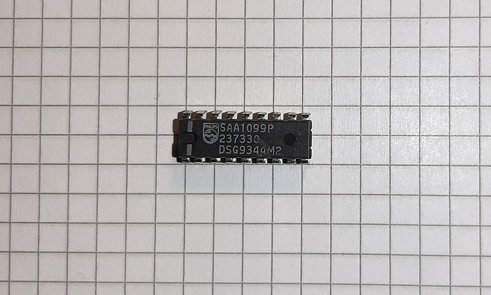
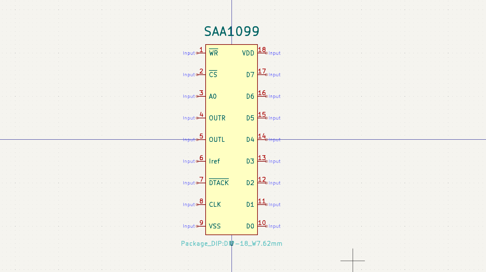

# SAA1099

> Parts of this README were generated using AI.

## General
- Creative Game Blaster and early Sound Blaster cards
- SAM Coupé
- some Silicon Graphics boards

The SAM Coupé got six voices from a single SAA1099. Each voice has its own left and right level, so a tune can put its bass, lead and noise percussion in different spots across the stereo mix. [SAM Coupé technical manual](sam-coupe_tech-man_v3-0.pdf)

## Files

- [SAA1099 datasheet](saa1099.pdf)
- [sam-coupe tech-man v3-0](sam-coupe_tech-man_v3-0.pdf)

## Links/Sources
- [Wikipedia](https://en.wikipedia.org/wiki/Philips_SAA1099)
