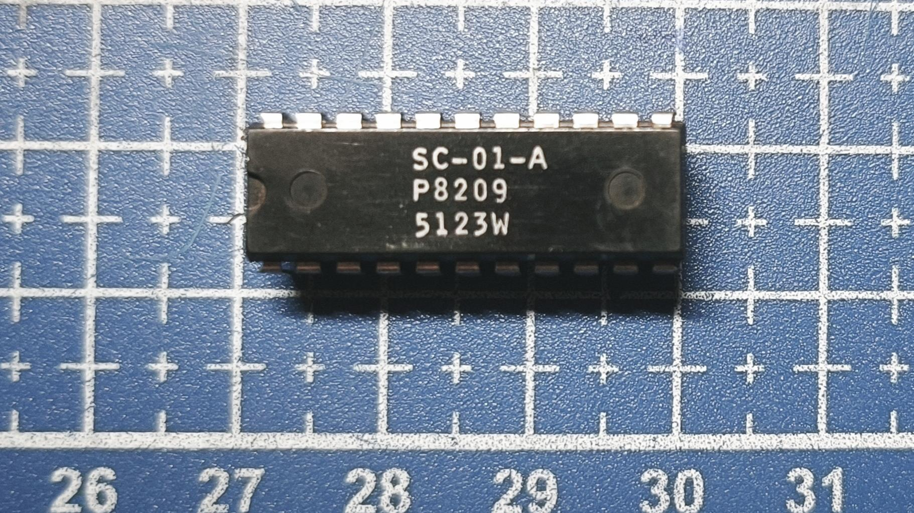

# SC-01

> Parts of this README were generated using AI.

*SC-01-A.*

## General

The Votrax SC-01 makes speech one sound at a time. It keeps the phonemes in an internal ROM, and an external controller strings them into words.

Gottlieb’s *Q\*bert* strings together Votrax phonemes for the character’s trademark gibberish. You can hear a recreation of the chip in the MiSTer FPGA port. [MiSTer Q\*bert project notes](https://github.com/MiSTer-devel/Arcade-QBert_MiSTer/blob/master/Readme.md)

## Files

- [Votrax SC-01 datasheet (1980)](Votrax_SC-01_Phoneme_Speech_Synthesizer_Data_Sheet_1980.pdf)
- [SC-01 Dictionary](SC-01%20Dictionary.pdf)

## Links/Sources

- [Vocal Synthesis Wiki](https://vocal-synthesis.fandom.com/wiki/Votrax_SC-01)
- [SC-01A Speech Synthesizer and Related ICs](https://www.redcedar.com/sc01.htm)
- [Votrax on Wikipedia](https://en.wikipedia.org/wiki/Votrax)
