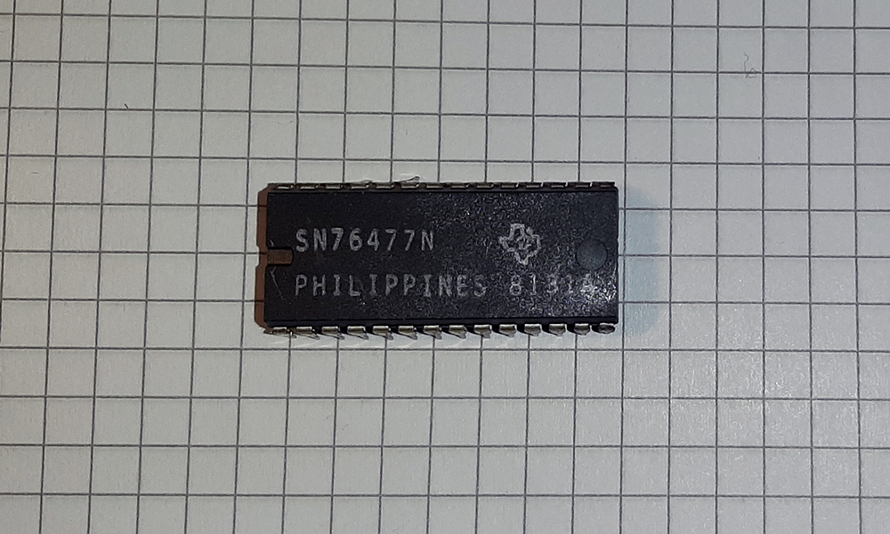

# SN76477

> Parts of this README were generated using AI.

## General

	

SN76477 "complex sound generator" is a sound chip produced by Texas Instruments (TI). The chip came to market in 1978.
The related [SN76488](../SN76488/) has a different pinout.

The flying saucer in the original *Space Invaders* gets its wobble from this chip. Listen for it at the top of the screen. [Ken Shirriff’s die and circuit analysis](https://www.righto.com/2017/04/reverse-engineering-76477-space.html)

## Files

- [SN76477 datasheet](sn76477datasheet.pdf)
- [SN76477 circuit article](SN76477article.pdf)

## Links/Sources

- [Wikipedia](https://en.wikipedia.org/wiki/Texas_Instruments_SN76477)
- [Reverse engineering the 76477](http://www.righto.com/2017/04/reverse-engineering-76477-space.html)
- [Achillies' website about SN76477/SN76488](https://www.achillies.com/Project_files/index.html)