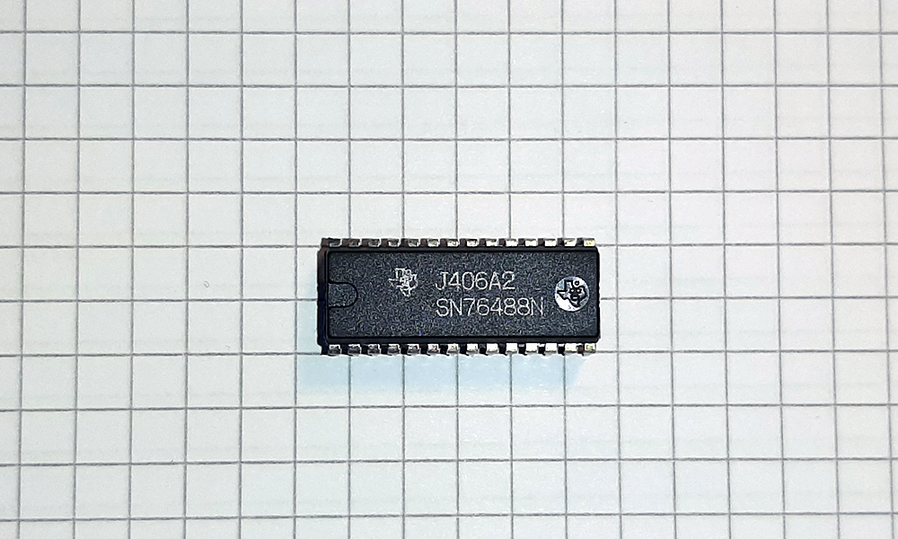

# SN76488

> Parts of this README were generated using AI.

## General

	

Sound effects chip related to the [SN76477](../SN76477/), with a different pinout. Output may vary with the supply voltage.

TI built a speaker amplifier into this version of its sound-effects chip. Like the SN76477, it uses external resistors and capacitors to shape the effects. [Texas Instruments datasheet](SN76488.pdf)

## Files

- [SN76488 datasheet](SN76488.pdf)

## Links/Sources

- [Achillies' website about SN76477/SN76488](https://www.achillies.com/Project_files/index.html)
