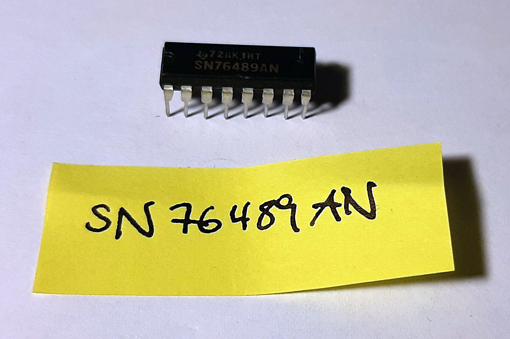
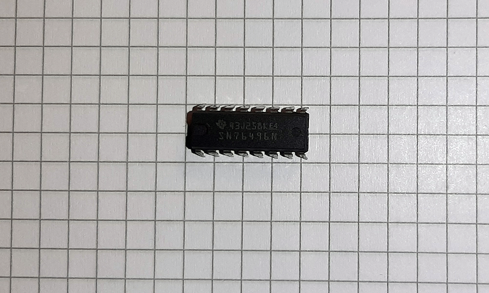
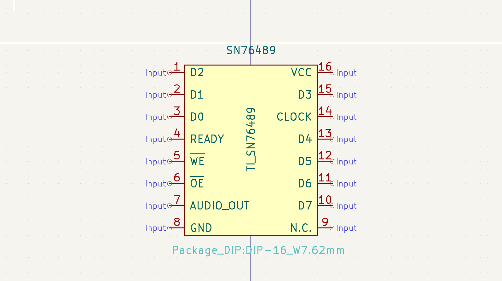

# SN76489

> Parts of this README were generated using AI.

*SN76489AN.*

## General

+ 3 Programmable Tone Generators
+ Programmable White Noise Generator
+ Programmable Attenuation
+ Simultaneous Sounds
+ TTL Compatible
+ Up to 4MHz Clock Input

Used in 
- TI 99/4A
- ColecoVision
- BBC Micro
- Tandy 1000
- Sega SG-1000 

Compatible PSGs were integrated in the video display processor of

- Sega Master System/Game Gear/Genesis

Other versions: SN76496N (with Audio-In)

The arcade *Lady Bug* used two SN76489s on one board, giving the game six tone generators and two noise generators to play with. [MAME’s Lady Bug hardware notes](https://github.com/mamedev/mame/blob/master/src/mame/universal/ladybug.cpp)

## Files

- [SN76489 datasheet](SN76489.pdf)

## Links/Sources
- [Wikipedia](https://en.wikipedia.org/wiki/Texas_Instruments_SN76489)
