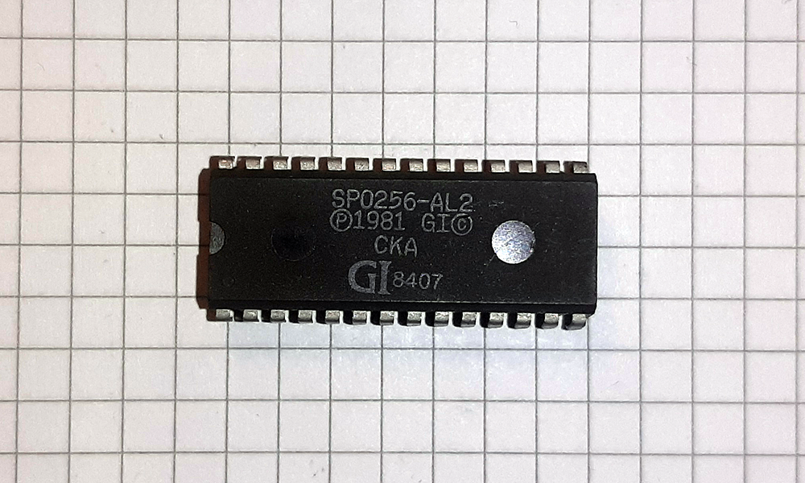
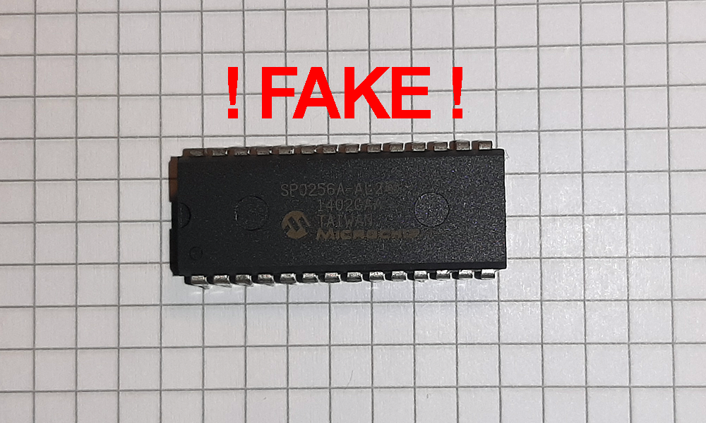

# SP0256

*SP0256A (DIP-28).*

## General
Speech synthesis, available as cartridge for

- Commodore VC20
- Atari 8-bit family
- TRS-80

There are many different versions around !

**Attention**: There are a lot of fake chips around ! I bought one from the Bay and seems to be just a cheap rebrandend DIP-28 IC !

## Files

- [General Instrument SP0256 datasheet](GI_SP0256.pdf)
- [General Instrument - SP0256A-AL2](General_Instrument_-_SP0256A-AL2.pdf)

## Links/Sources
- [Wikipedia](https://en.wikipedia.org/wiki/General_Instrument_SP0256)
