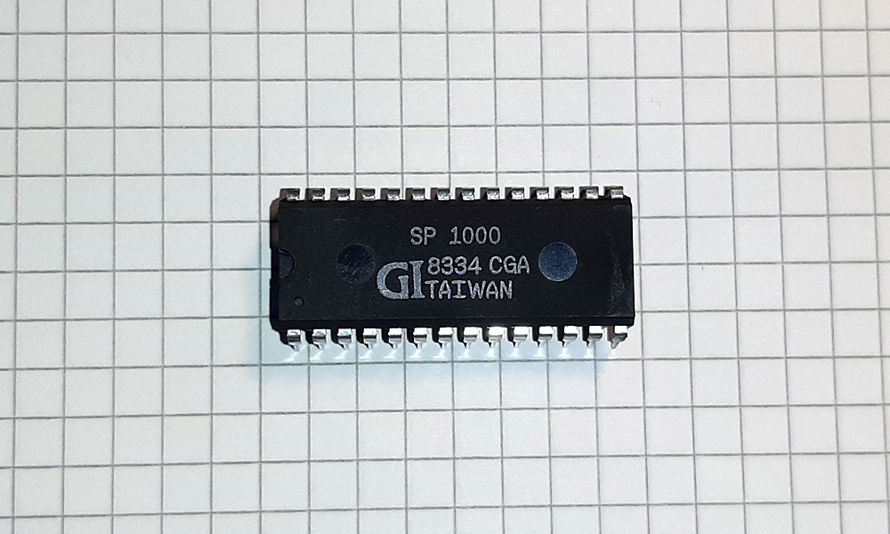

# SP1000

> Parts of this README were generated using AI.

## General

	

General Instrument combined speech synthesis and recognition in this 5 V chip.

Micromint put this chip on the Apple II’s LIS’NER 1000 card, so one add-on could listen for spoken commands and talk back. [Micromint LIS’NER 1000 manual](https://mirrors.apple2.org.za/Apple%20II%20Documentation%20Project/Interface%20Cards/Speech/Micromint%20Lis%27ner/Manuals/lisner-1000-rev-2.0-manual.pdf)

## Files

- [SP1000 datasheet](sp1000.pdf)

## Links/Sources
- [Jeff's quickie page of vintage ICs/chips](http://www.ferretronix.com/tech/chips/index.html)
