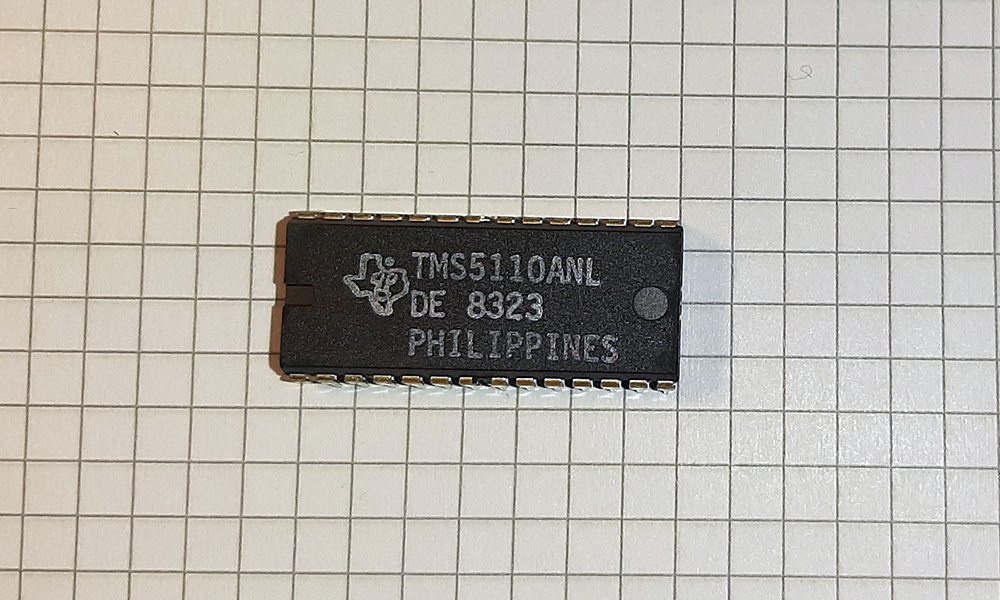
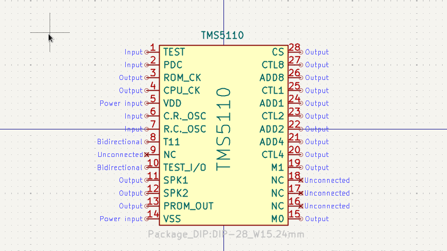

# TMS5110

> Parts of this README were generated using AI.

## General

	

Texas Instruments LPC speech synthesizer.

Valadon’s *Bagman* arcade board paired the TMS5110 with a little ROM-driven state machine to feed it speech commands. [MAME’s Bagman board notes](https://github.com/mamedev/mame/blob/master/src/mame/valadon/bagman.cpp)

## Files

- [TMS5110 technical reference](DSAP005264.pdf)

## Links/Sources

- [Wikipedia about TI LPC speech chips](https://en.wikipedia.org/wiki/Texas_Instruments_LPC_Speech_Chips)
- [Speech synthesizer investigations](https://hackaday.io/project/191735-finding-the-hidden-speak-spell-in-a-renault-25/log/221276-speech-synthesizer-investigations)