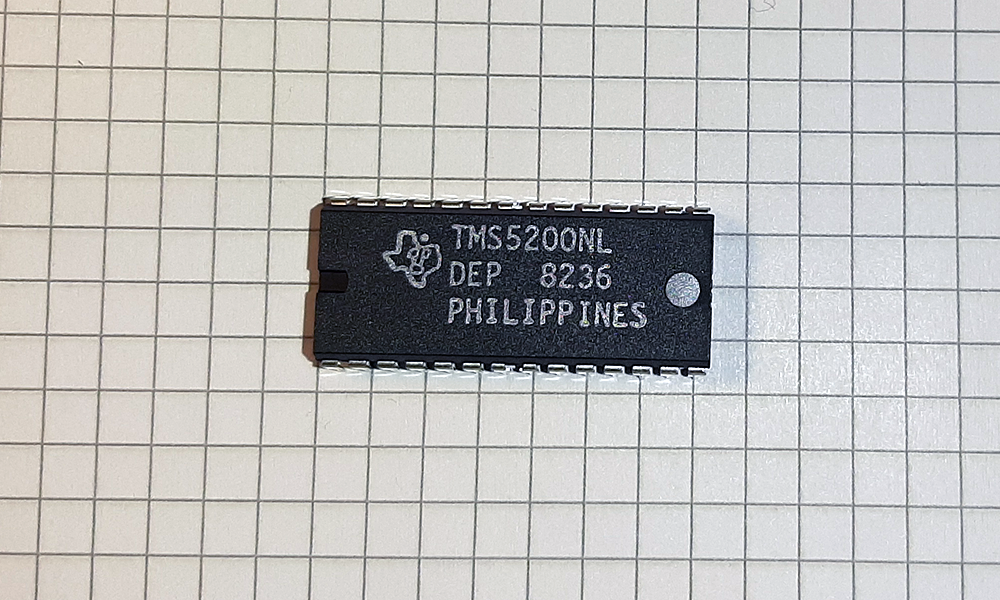

# TMS5200

> Parts of this README were generated using AI.

## General

	

The TMS5200 also went by TMC0285. [Designer Larry Brantingham’s comments, reproduced on Pinside](https://pinside.com/pinball/forum/topic/tms5220-as-a-replacement-for-tms5200-in-a-bally-squawk-and-talk)

Bally’s Squawk & Talk pinball boards used the TMS5200 family to give machines a voice. The [TMS5220](../TMS5220/) reads the same speech frame layout, but its different voice tables can change how an old recording sounds. [MAME’s TI speech chip notes](https://github.com/mamedev/mame/blob/master/src/devices/sound/tms5220.cpp)

## Files

- [TMS5200 datasheet](TMS5200.pdf)

## Links/Sources

- [Wikipedia about TI LPC speech chips](https://en.wikipedia.org/wiki/Texas_Instruments_LPC_Speech_Chips)
