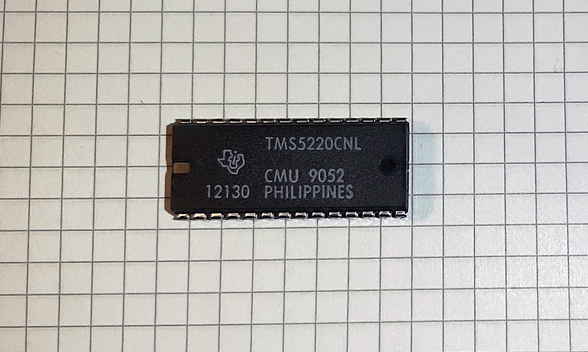

# TMS5220 / TMS5220C

> Parts of this README were generated using AI.

## General

*TMS5220 (DIP-28).*

Speech synthesis, data can come from ROM (TMS6100) or CPU

- BBC Micro, IBM Speech Adapter
- Several arcades (Gauntlet, Star Wars, Firefox...)

PHROMS are in the named folder, a TMS6100 hardware emulator instruction is [here](https://www.waitingforfriday.com/?p=30)

In Atari’s 1983 *Star Wars* arcade cabinet, the TMS5220 handled the spoken lines, alongside four POKEYs for the rest of the audio. [MAME’s Star Wars hardware notes](https://github.com/mamedev/mame/blob/master/src/mame/atari/starwars.cpp)

### TMS5220

The TMS5220, released in 1980, was used in several home computer peripherals and arcade games. Uses the 'final' chirp table. HP 82967A Speech synthesis module, adding 1500-word vocabulary to Series 80 computers. It was made until around 1983 when it was replaced by the TMS5220C.

### TMS5220C

The TMS5220C, released in 1983, was an improved TMS5220. It reworked the two NOP (No Operation) commands and the parallel FIFO interface to allow for variable-speed speech and was fully compatible with the TMS5220. Those chips produced after 1985 used the number "TSP5220C". It was made until the early 1990s.

## Files

- [TMS5220 datasheet](tms5220.pdf)
- [tms6100-80-data-manual](tms6100-80-data-manual.pdf)

## Links/Sources

- [Wikipedia about TI LPC speech chips](https://en.wikipedia.org/wiki/Texas_Instruments_LPC_Speech_Chips)
- [TMS5220 at VGMPF](http://www.vgmpf.com/Wiki/index.php?title=TMS5220)
