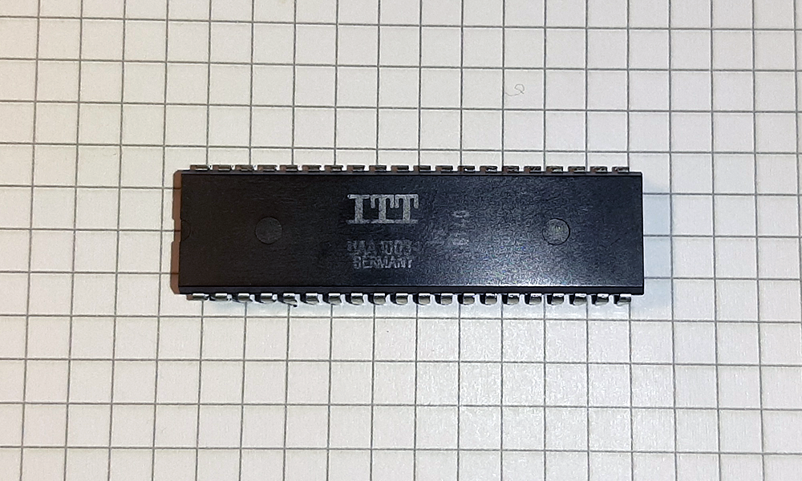

# UAA1003

> Parts of this README were generated using AI.

## General

	

Speech chip for talking clocks.

- UAA1003-1 German
- UAA1003-2 French
- UAA1003-3 English

The clock got its vocabulary from the chip itself. To change the language, you’d swap the chip. [ITT datasheet](uaa1003.pdf)

## Files

- [UAA1003 datasheet](uaa1003.pdf)
- [ITT UAA1003 GERMAN](ITT_UAA1003_GERMAN.pdf)
