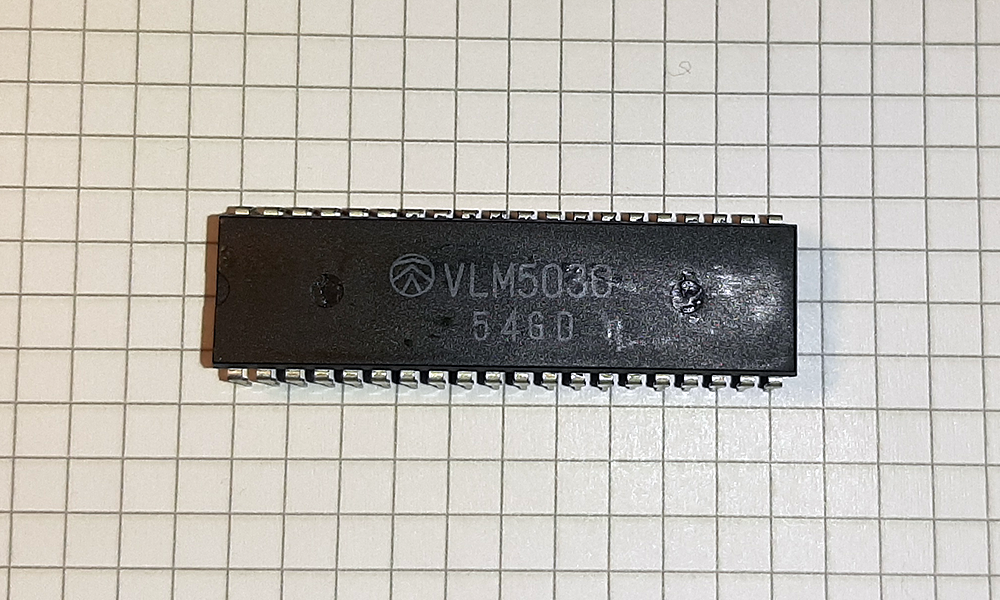

# VLM5030

> Parts of this README were generated using AI.

## General

	

Sanyo speech synthesizer used in several 1980s arcade games.

Konami’s *Jail Break* put a VLM5030 on the arcade board alongside an SN76489-family sound chip. Speech had its own chip and ROM, separate from the tones and noise. [MAME’s Jail Break board notes](https://github.com/mamedev/mame/blob/master/src/mame/konami/jailbrek.cpp)

## Files

- [vlm5030-pinout](vlm5030-pinout.png)
- [Jail Break Conversion Kit Instruction Manual With Schematics](Jail%20Break%20Conversion%20Kit%20Instruction%20Manual%20With%20Schematics.pdf)

## Links/Sources

- [VLM5030 on VGMPF](http://www.vgmpf.com/Wiki/index.php?title=VLM5030)