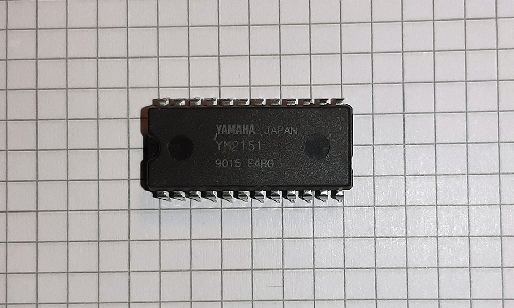

# YM2151

## General

- Arcade systems (Sega, Konami, Capcom, ...)

This chip needs an external DAC (YM3012)

## Files

- [yamaha ym2151 datasheet](yamaha_ym2151_datasheet.pdf)

## Links/Sources

- [Wikipedia](https://en.wikipedia.org/wiki/Yamaha_YM2151)
