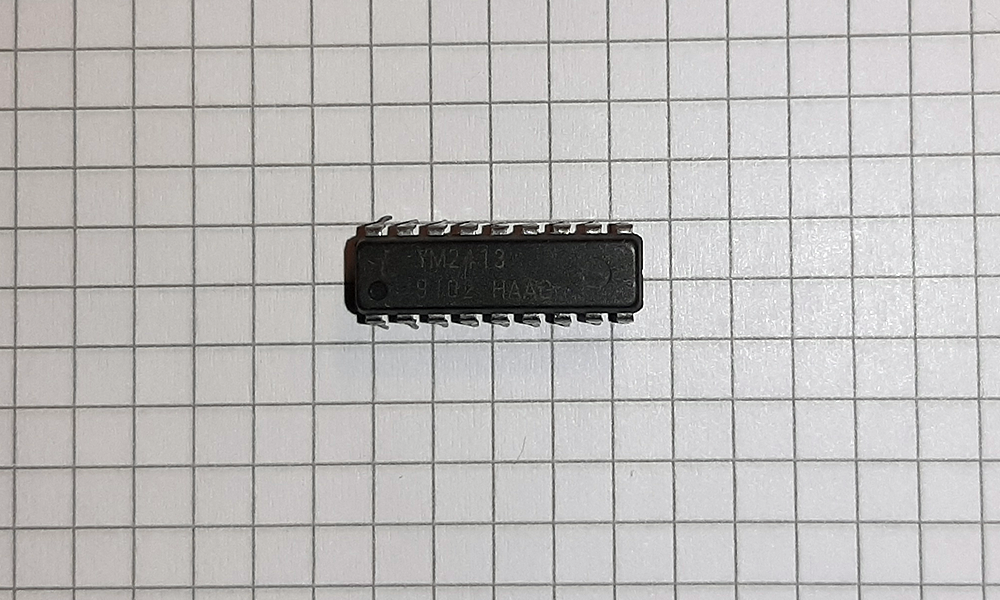

# YM2413

> Parts of this README were generated using AI.

## General
Yamaha’s OPLL turned up in arcade boards, home consoles and keyboards.

The Japanese Master System used this chip for its FM soundtrack option. The YM2413 comes with 15 melodic presets and room for one custom voice shared across channels. [MAME’s Master System hardware notes](https://github.com/mamedev/mame/blob/master/src/mame/sega/sms.cpp) · [Yamaha datasheet](ym2413.pdf)

## Files

- [YM2413 datasheet](ym2413.pdf)

## Links/Sources
- [Wikipedia](https://en.wikipedia.org/wiki/Yamaha_OPL#OPLL)
