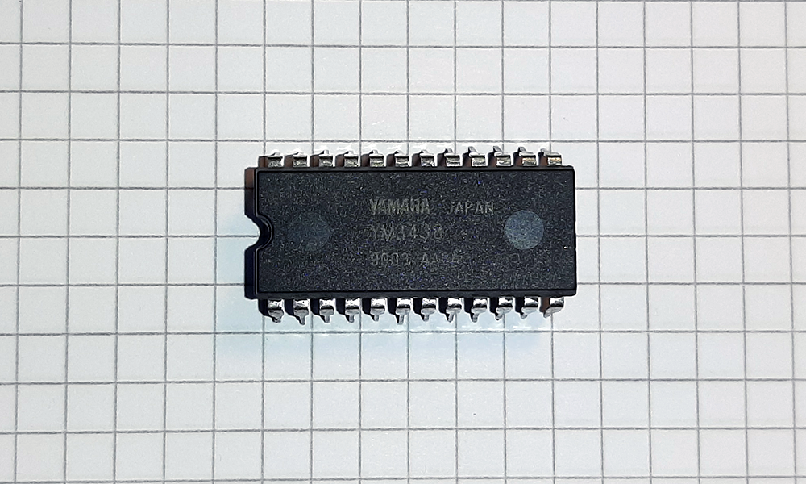

# YM3438

> Parts of this README were generated using AI.

## General

	

The YM3438, a.k.a. OPN2C, is a modified CMOS version of the YM2612, commonly used in Sega's arcade system boards. This version has an improved built-in DAC that reduced the peculiar crossover distortions caused by the amplitude voltage errors present in the YM2612. It is not a direct, drop-in replacement for the YM2612 however, as the sound outputs have higher impedance.

Sega’s System 32 arcade hardware could use two YM3438s side by side, with a separate PCM chip for samples. That’s twice the FM channels of a Mega Drive. [MAME’s System 32 board notes](https://github.com/mamedev/mame/blob/master/src/mame/sega/segas32.cpp)

## Features

- Six concurrent FM synthesis channels (voices)
- Four operators per channel
- Two interval timers
- A sine-wave low frequency oscillator
- Integrated stereo output digital-to-analog converter (most other contemporary Yamaha FM chips require a separate external D/A converter chip)
- Per-channel programmable stereo sound (left, right, or both left and right resulting in centre)
- For channel three, operator frequencies can be set independently, making dissonant harmonics possible. (Normally, they would have a simple relation like e.g. 2× or 3× relative to a common base frequency)

## Files

- [YM3438 datasheet (Japanese)](YM3438_JP.pdf)
- [YM2612-Yamaha](YM2612-Yamaha.pdf)
- [GenesisTechnicalOverview](GenesisTechnicalOverview.pdf)

## Links/Sources

- [Wikipedia on YM2612](https://en.wikipedia.org/wiki/Yamaha_YM2612)
- [A DIY synth based on YM2612/3438](https://www.sequencer.de/synthesizer/threads/dafm-synth-genesis-ym2612-ym3438.150511/)
- [Details about the YM2612/3438](https://segaretro.org/YM2612)
- [Sega Genesis Technical Manual - YM2612 section](https://www.smspower.org/maxim/Documents/YM2612)
