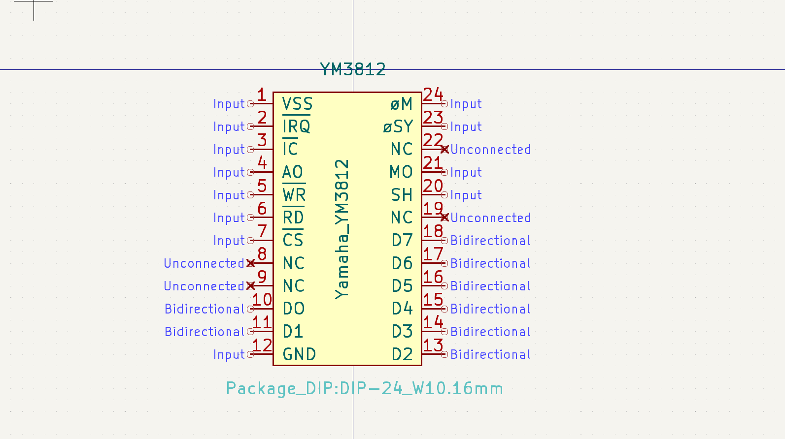

# YM3812

> Parts of this README were generated using AI.

## General

Yamaha’s OPL2 FM synthesizer.

The AdLib card put the YM3812 in a lot of DOS PCs. Its rhythm mode trades three of the nine melodic channels for five drum sounds, so a whole rhythm section can come from the FM chip. [Yamaha datasheet](ym3812.pdf) · [MAME’s AdLib card implementation](https://github.com/mamedev/mame/blob/master/src/devices/bus/isa/adlib.cpp)

## Files

- [YM3812 datasheet](ym3812.pdf)
- [YM3014B DAC](YM3014B_DAC.pdf)

## Links/Sources

- [Wikipedia](https://en.wikipedia.org/wiki/Yamaha_OPL#OPL2)
